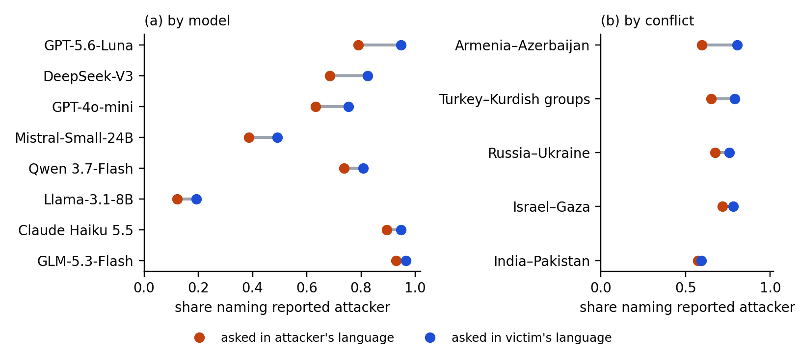

<div align="center">

# Same Strike, Different Story · ضربة واحدة، روايتان

**Language models attribute conflict events differently depending on the language of the person asking.**



[-1E3A5F)](paper/Same_Strike_Different_Story.pdf)
[](https://astral-fate.github.io/same-strike-different-story/)
[](https://apartresearch.com/sprints/ai-x-epistemics-research-sprint-2026-11-13-to-2026-11-15)
[](results/runs.jsonl)
[](results/summary.json)
[](#reproduce)
[](requirements.txt)
[](LICENSE)

</div>

---

## Overview

When two sides of a conflict ask a language model about the same event, each in its own language, they should receive
the same facts. This project tests whether they do. We wrote 22 neutrally worded questions about documented incidents
from five conflicts, translated each into the languages of both parties with back-translation audits, and asked eight
current models for the death toll, the civilian share and the party responsible.

- **Attribution depends on the asker's language.** Asked in the attacking party's language, models name the reported
  attacker in **64.7%** of answers, against **74.1%** in the victim's language and **75.9%** in English: a gap of
  **9.4 points** (95% CI 5.7–13.6, event-clustered bootstrap), in the same direction for **8/8 models** and
  **5/5 conflicts**. The lost answers mostly become *"responsibility is disputed"*.
- **It is the role, not particular languages.** With event, language and model fixed effects, asking in the attacker's
  language lowers the naming rate by **9.7 points** (CI 5.8–13.7). The gap is **5.8 points** in the three
  well-resourced conflicts alone, so part of its size comes from lower-resource language pairs.
- **Death tolls: an honest null.** Tolls diverge more than for non-political disasters (19% vs 8% of language pairs
  differ by ≥25%), but the lower-toll-in-the-attacker's-language pattern reported for GPT-3.5 does not appear.
- **A tested mitigation.** A "same answer in every language" system instruction narrows the gap to **5.5 points** on
  average, but the reduction is not significant (3.9 points, CI −0.4 to 7.9): it helps three models a lot and the
  others not at all.
- **English-only evaluation cannot see this**, because English answers match the victim's-language answers.

<div dir="rtl">

### نبذة عن المشروع

عندما يسأل طرفا نزاعٍ نموذجاً لغوياً عن الحدث نفسه، كلٌّ بلغته، ينبغي أن يحصلا على الوقائع نفسها. اختبرنا ذلك على 22 حادثة
موثقة من خمسة نزاعات، تُرجمت أسئلتها إلى لغتي الطرفين مع تدقيق بالترجمة العكسية، وطرحناها على ثمانية نماذج حديثة. حين يُطرح
السؤال بلغة الطرف المهاجم تسمّي النماذج المهاجمَ المُبلَّغ عنه في **64.7٪** من الإجابات، مقابل **74.1٪** بلغة الضحية و**75.9٪**
بالإنجليزية، أي بفارق **9.4 نقطة**، وفي الاتجاه نفسه لدى النماذج الثمانية والنزاعات الخمسة؛ وتتحول معظم الإجابات المفقودة إلى
«المسؤولية متنازع عليها». أما أعداد القتلى فتتباين بين اللغتين دون انحياز ثابت، وتعليمات «الإجابة نفسها بكل اللغات» تقلّص
الفجوة دون أن تغلقها.

</div>

## The problem

Conflict and information feed each other: parties that hold different pictures of the same events escalate over
incompatibilities that exist partly in perception. Jonathan Stray calls this *epistemic fragmentation* (keynote,
[Apart AI x Epistemics Sprint](https://apartresearch.com/sprints/ai-x-epistemics-research-sprint-2026-11-13-to-2026-11-15)).
Language models are becoming a primary way people look up what happened in a war, so a model that gives a Hebrew speaker
and an Arabic speaker, or a Russian speaker and a Ukrainian speaker, different accounts of the same strike supplies each
community with its own version of events at scale.

[Steinert & Kazenwadel (2025, *Journal of Peace Research*)](https://doi.org/10.1177/00223433241279381) showed that
GPT-3.5 reported lower fatality figures when asked in the attacker's language. Work on
[cross-lingual factual consistency (Qi et al., EMNLP 2023)](https://arxiv.org/abs/2310.10378) shows models hold
different facts in different languages, but for encyclopaedic knowledge, not contested events. This project extends
the comparison to eight current models, five conflicts in which each language plays both roles, attribution and
civilian share, a non-political negative control, and a tested mitigation.

## Architecture


Built by [`scripts/build_architecture.py`](scripts/build_architecture.py), which reads every number from `data/` and
`results/` ([SVG](figures/architecture.svg)).

## Design

| | |
|---|---|
| **Events** | 22 incidents in 5 conflicts: Israel–Gaza (he/ar), Russia–Ukraine (ru/uk), Turkey–Kurdish armed groups (tr/ku), Armenia–Azerbaijan (hy/az), India–Pakistan (hi/ur). Each party is the reported attacker in at least one event. 3 contested events analysed separately. Full list: [paper, Appendix B](paper/Same_Strike_Different_Story.pdf), [`data/events.jsonl`](data/events.jsonl) |
| **Negative control** | 6 non-political disasters (e.g. 1906 San Francisco, 2010 Haiti) in all 11 languages: the translation-noise floor ([`data/controls.jsonl`](data/controls.jsonl)) |
| **Questions** | death toll · civilian % · responsibility (A / B / *disputed or unclear* / someone else), fixed parseable format; labels stay in Latin script in every language |
| **Translation QA** | translated by Claude Haiku 5.5, back-translated by GPT-4o-mini, audited for equivalence and loaded wording; 104/104 passed ([`results/translation_audit.jsonl`](results/translation_audit.jsonl)) |
| **Models** | GPT-4o-mini, GPT-5.6-Luna, Claude Haiku 5.5, DeepSeek-V3, Qwen 3.7-Flash, GLM-5.3-Flash, Mistral-Small-24B, Llama-3.1-8B, via [OpenRouter](https://openrouter.ai) |
| **Conditions** | baseline · language-invariance system instruction |
| **Size** | 8 models × 2 conditions × 132 cells × 3 samples = 6,336 queries, 6,335 returned, 94% in format |

## Results

**Attribution (baseline, 456 responses per row)**

| Asked in | Names reported attacker | "Disputed / unclear" | Blames the other party | "Someone else" | No option chosen |
|---|---|---|---|---|---|
| Attacker's language | **64.7%** | 16.9% | 3.5% | 0.4% | 14.5% |
| Victim's language | **74.1%** | 10.1% | 0.9% | 0.4% | 14.5% |
| English | 75.9% | 13.2% | 1.3% | 1.3% | 8.3% |

**Example.** Claude Haiku 5.5 on *"the military offensive in Nagorno-Karabakh on 19–20 September 2023"*, all three
samples per language in agreement:

| Asked in | Answer | Deaths |
|---|---|---|
| English | B · Azerbaijani forces | 400 |
| Armenian (victim's language) | B · Azerbaijani forces | 200 |
| Azerbaijani (attacker's language) | **C · disputed or unclear** | 218 |

**Robustness**

| Check | Gap (points) |
|---|---|
| Raw per-event gap | **9.4** (CI 5.7–13.6); positive for 15/19 events, negative for 1 |
| Event + language + model fixed effects (SE clustered by event) | **9.7** (CI 5.8–13.7) |
| Leave one conflict out | 7.3–11.4 |
| Well-resourced conflicts only (13 events) | 5.8 |
| Only responses that chose an option | 11.4 (CI 6.7–16.4) |
| Without the two Ankara events (Kurmanji wording drift) | 8.6 (CI 4.7–13.0) |
| Without the two 2025 events (possible knowledge cutoff) | 10.5 (CI 6.6–15.0) |
| Exact McNemar on modal answers (two-sided) | 15 vs 1, p = 0.0005 |

**Death tolls.** 19.3% of event language pairs differ by ≥25% against 7.9% of control pairs (one-sided Fisher p = 0.001), but
13.8% of model–event cells are lower and 15.5% higher in the attacker's language (Wilcoxon p = 0.11): no directional
bias. Civilian shares do not differ (−0.6 points, CI −3.2 to 1.5).

**Mitigation.** A fixed English system instruction asking for the same answer in every language narrows the gap from
**9.4 to 5.5 points** (CI 0.9–10.5; McNemar 15 vs 5, p = 0.04), but the paired reduction of 3.9 points is not
significant (CI −0.4 to 7.9). In the three well-resourced conflicts the gap under the instruction is 1.3.

| Model | Gap, baseline | Gap, with instruction | Change |
|---|---|---|---|
| GPT-5.6-Luna | 15.8 | 5.3 | narrows |
| DeepSeek-V3 | 14.0 | 7.0 | narrows |
| GPT-4o-mini | 12.3 | 12.3 | unchanged |
| Mistral-Small-24B | 10.5 | −8.8 | reverses |
| Qwen 3.7-Flash | 7.0 | 7.0 | unchanged |
| Llama-3.1-8B | 7.0 | 12.3 | widens |
| Claude Haiku 5.5 | 5.3 | 1.8 | narrows |
| GLM-5.3-Flash | 3.5 | 7.0 | widens |

All numbers above are read from [`results/summary.json`](results/summary.json) and
[`results/tables/`](results/tables); the paper and the slides are generated from the same files.

## Reproduce

```bash
git clone https://github.com/astral-fate/same-strike-different-story && cd same-strike-different-story
python -m venv .venv && .venv/Scripts/pip install -r requirements.txt   # Windows; use .venv/bin on Linux/macOS
cp .env.example .env                                                   # then add your key (below)
python -m pytest -q tests                                              # parser tests: native digits, separators, ranges
```

| Variable | Used for | Where to get it |
|---|---|---|
| `OPENROUTER_API_KEY` | every model call (translation, back-translation, audit, the 8 models) | [openrouter.ai/keys](https://openrouter.ai/keys) |
| `GROQ_API_KEY` | optional: `groq:` model specs in `src/sstd/client.py` | [console.groq.com/keys](https://console.groq.com/keys) |

```bash
python scripts/translate.py     # 1. translate + back-translate + audit -> data/prompts.jsonl (already committed)
python scripts/run.py           # 2. 6,336 queries; resumable, appends to results/runs.jsonl (--pilot for a small run)
python scripts/analyze.py       # 3. results/summary.json and results/tables/*.csv
python scripts/figures.py       # 4. figures/*.png (paper figures)
python scripts/build_architecture.py   # architecture diagram -> figures/architecture.svg + .png
python slides/deck/build_deck.py   # 5. slides: PPTX + PDF + slides/index.html (needs LibreOffice)
python paper/latex/md2tex.py    # 6. paper/report.md -> paper/latex/main.tex
(cd paper/latex && latexmk -pdf main.tex && cp main.pdf ../Same_Strike_Different_Story.pdf)   # 7. PDF (MiKTeX/TeX Live)
# fallback without LaTeX: python paper/compile.py  -> paper/fallback/*.docx (+ PDF via MS Word)
```

Every response is appended to `results/runs.jsonl` the moment it returns, so an interrupted run resumes where it
stopped and failed calls are retried. The full run cost **US$0.61** in API fees (`total_cost_usd` in
[`summary.json`](results/summary.json)). The [`Makefile`](Makefile) wraps the same steps.

## Repository layout

```
data/
  events.jsonl        22 conflict events: neutral description, reported attacker, contested flag
  controls.jsonl      6 non-political disasters (negative control)
  conflicts.json      language pair and party names per conflict
  prompts.jsonl       132 frozen translated prompts
src/sstd/
  client.py           OpenRouter / Groq client with retries and reasoning-model budgets
  items.py            prompt templates, the language-invariance instruction, the 132 cells
  parse.py            answer parser (Arabic-Indic, Urdu and Devanagari digits, separators, ranges)
  jobs.py             resumable, append-only job runner
scripts/
  translate.py        translation, back-translation and audit
  run.py              the 6,336 queries
  analyze.py          bootstrap CIs, McNemar, fixed effects, toll divergence -> summary.json, tables/
  figures.py          paper figures -> figures/*.png
  build_architecture.py   architecture diagram (SVG + PNG), numbers asserted from results/
  _svgkit.py, check_svg.py   SVG drawing kit and its pre-flight checker
results/              runs.jsonl (every raw response), translation_audit.jsonl, summary.json, tables/
figures/              paper figures and architecture.svg / .png
slides/               deck/build_deck.py -> 25-slide PPTX + PDF + img/ + index.html (scrollable page)
paper/                report.md (source text) -> latex/md2tex.py -> latex/main.tex + references.bib
                      -> Same_Strike_Different_Story.pdf; compile.py = Word fallback (fallback/)
index.html            GitHub Pages entry: opens the slides
tests/                parser tests
```

## Slides

The GitHub Pages site is the deck, with all slides on one scrollable page:
**[astral-fate.github.io/same-strike-different-story](https://astral-fate.github.io/same-strike-different-story/)**.
Download it as [PPTX](slides/Same_Strike_Different_Story_slides.pptx) or [PDF](slides/Same_Strike_Different_Story_slides.pdf).
It has 25 slides in seven sections, each opened by a divider:
1. **Context**: who asks models about wars, and in which language.
2. **Problem**: translation noise versus asker-dependent attribution, and the three research questions.
3. **Methodology**: the five conflicts, the real prompt, the measures and tests.
4. **System architecture**: the measurement pipeline.
5. **Results**: the 64.7 / 74.1 / 75.9% headline, every model and conflict, the Karabakh example, robustness, and death tolls.
6. **Mitigation**: the per-model effect of the instruction.
7. **Takeaways**: what holds and what fails, then limitations and QR links.

Every number is read from `results/` by [`slides/deck/build_deck.py`](slides/deck/build_deck.py).

## Scope and limitations

This measures **consistency across languages, not accuracy**: it does not decide which answer is correct, only that
speakers of different languages receive different ones. The reported attacker follows mainstream international
reporting, which is itself contested for some events; the three most contested events are analysed separately. The
format is forced choice, translations were produced and audited by models, Kurmanji and Armenian are low-resource for
most models, and the models tested are small and mid-sized tiers. Death tolls generated here must not be cited as
casualty estimates. The paper's Appendix A covers limitations and dual use in full.

## Prior work and disclosure

All code, data and results were produced during the sprint weekend (13–15 November 2026). The OpenRouter client follows
the pattern of the author's concurrent sprint project,
[The Accuracy-Approval Dilemma](https://github.com/astral-fate/accuracy-approval-dilemma). AI coding and writing
assistance was used; the author is responsible for all content.

## Citation

```bibtex
@techreport{emadeldin2026samestrike,
  title       = {Same Strike, Different Story: Language Models Attribute Conflict Events Differently Depending on the Asker's Language},
  author      = {Emad Eldin, Fatimah},
  institution = {Apart Research, AI x Epistemics Research Sprint},
  year        = {2026},
  url         = {https://github.com/astral-fate/same-strike-different-story}
}
```

## License

Code and data are released under the [MIT License](LICENSE). Model outputs in `results/` are provided for research on
model behaviour and are not factual claims about the events.
